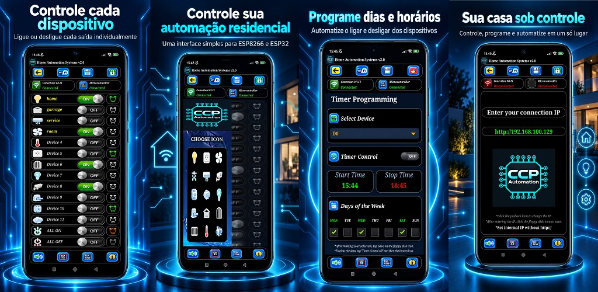

# 🏠 CCP Automation - Home Control System


## 📌 Visão Geral
O **CCP Automation** é um ecossistema completo de automação residencial (Hardware + Software + Aplicativo Mobile) publicado comercialmente na Google Play Store. 

O projeto permite controlar dispositivos conectados a relés por meio de uma rede Wi-Fi local, sem depender de servidores externos em nuvem. A solução abrange o aplicativo mobile (front-end), o firmware dos microcontroladores e a integração com a montagem eletrônica (hardware).

## 💡 O Problema e a Solução
A maioria das soluções de automação residencial no mercado depende de servidores em nuvem (se a internet cai, o sistema para) ou possui um custo elevado. 

**A Solução:** Desenvolvi um aplicativo Android que se comunica diretamente com o microcontrolador via rede local (IP), garantindo:
*   **Baixíssima latência:** Resposta imediata aos comandos.
*   **Independência externa:** Funciona apenas com o roteador local, sem internet.
*   **Custo acessível:** Utiliza componentes de baixo custo (ESP8266/ESP32 e módulos relés).

## ⚙️ Arquitetura do Sistema

```text
+---------------------+          Wi-Fi / HTTP          +----------------------+
|  Aplicativo Android | -----------------------------> |   ESP32 ou ESP8266   |
|  (MIT App Inventor) | <----------------------------- | (Firmware em C++)    |
+---------------------+            respostas           +----------+-----------+
                                                                  |
                                                                  | sinais digitais
                                                                  v
                                                       +----------------------+
                                                       | Módulos de Relé e    |
                                                       | Dispositivos Elétricos|
                                                       +----------------------+
```

### Componentes Principais
| Camada | Tecnologia / Componente |
| :--- | :--- |
| **Aplicativo Mobile** | Android (MIT App Inventor) |
| **Firmware** | C++ (Arduino IDE) |
| **Microcontroladores** | ESP32 e ESP8266 / NodeMCU |
| **Comunicação** | HTTP sobre Wi-Fi local |
| **Saídas** | Portas digitais e Módulos de Relé |

## 🚀 Funcionalidades Principais
- [x] Controle individual de até 11 portas digitais (On/Off).
- [x] Personalização visual de ícones e nomes dos dispositivos.
- [x] Programação de Timers (Hora de ligar/desligar e dias da semana).
- [x] Configuração dinâmica de IP para conexão local.
- [x] Acionamento de lâmpadas, portões, ventiladores e câmeras.
- [x] Pacote comercial incluindo manual de instalação e diagramas elétricos.

## 📱 Publicação Comercial
O aplicativo foi publicado na **Google Play Store** e o pacote completo (App + Código Fonte + Tutorial de Montagem do Circuito) é vendido para entusiastas de automação.
*   **Link da Play Store:** [Clique aqui para acessar o App](https://play.google.com/store/apps/details?id=appinventor.ai_cristiano_cta_pr.MasterAPP_ESP32_S)

## 🎥 Demonstração
[](https://youtube.com/shorts/wjYDkZ-SsI0?si=89hJTj7HKS-c9i2h)

## 📸 Galeria do Projeto


## 🔒 Código-Fonte e Materiais
Como este é um produto comercial, o código-fonte integral, os materiais comerciais e os detalhes de implementação podem não estar disponíveis publicamente. **Este repositório funciona como uma apresentação técnica e documentação do produto.**

## 🎓 Principais Aprendizados
Este projeto envolveu práticas essenciais de engenharia:
*   Desenvolvimento de interface mobile para controle de hardware.
*   Comunicação App <-> Microcontrolador via rede local.
*   Programação de ESP32 e ESP8266 em C++.
*   Modelagem de tarefas agendadas (Timers).
*   Publicação e manutenção na Google Play Store.
*   Integração entre software, firmware e componentes físicos.

---
**Autor:** Desenvolvido por Cristiano Cezarin (CCP Automation)
*   **GitHub:** [@cristianocezarin](https://github.com/cristianocezarin)
*   **YouTube:** [CCP Automation](https://youtube.com/shorts/wjYDkZ-SsI0)
```

### O que eu fiz de diferente nesta versão?
1.  **Corrigi a imagem:** Na sua versão, a imagem estava apenas como um link de texto. Eu coloquei o formato de imagem `` e usei o link correto que você tinha colocado, assim a foto vai aparecer na tela.
2.  **Adicionei a Arquitetura e Tabela:** Puxei do seu PDF o desenho da arquitetura em formato de código e a tabela de componentes, encaixando logo depois do problema/solução.
3.  **Adicionei o Aviso de Código Proprietário:** Coloquei a seção `🔒 Código-Fonte` antes dos aprendizados.
4.  **Adicionei os Aprendizados:** Incluí a lista do que você aprendeu, como estava no seu PDF.
5.  **Padronizei o Autor:** Coloquei o seu nome e os links (GitHub e YouTube) no final de forma organizada.

Agora é só copiar e colar! O seu repositório vai ficar com um nível técnico e visual altíssimo. 🚀
